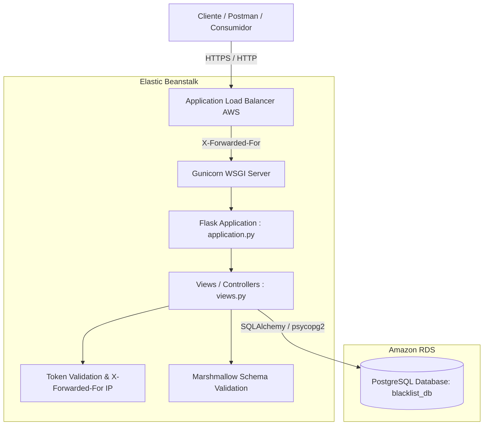

# Blacklist Microservice - Entrega 1
# Blacklist Microservice

Microservicio de gestión de listas negras globales desarrollado en **Flask**, diseñado bajo principios de arquitectura limpia, empaquetado y desplegado de forma nativa en **AWS Elastic Beanstalk** con persistencia en **Amazon RDS (PostgreSQL)**.
Microservicio REST en Flask para gestión de listas negras globales, con pruebas unitarias automatizadas (`pytest`), contenerización en Docker, infraestructura definida en Terraform y pipeline CI/CD sobre AWS (CodePipeline, CodeBuild, Amazon ECR y ECS Fargate).

---

## 1. Arquitectura y Estructura del Proyecto
## 1. Estructura del Repositorio

El microservicio utiliza el patrón de diseño WSGI estándar para Elastic Beanstalk: el archivo de entrada se denomina `application.py` y la instancia exportada de Flask se llama `application`.

```plaintext
blacklist-microservice/
├── .ebextensions/
│   └── 01_flask.config          # Configuración WSGI y variables de entorno para AWS EB
pass_blacklist/
├── application.py               # Entry point WSGI de la aplicacion Flask
├── config.py                    # Configuracion de base de datos y tokens
├── models/
│   ├── __init__.py
│   └── models.py                # Entidad SQLAlchemy (Blacklist) y Esquema Marshmallow
│   └── models.py                # Modelo SQLAlchemy (Blacklist) y esquema Marshmallow
├── views/
│   ├── __init__.py
│   └── views.py                 # Controladores Flask-RESTful, seguridad y Health Check
│   └── views.py                 # Endpoints REST, autenticacion Bearer y /health
├── tests/
│   └── test_blacklist.py        # 8 pruebas unitarias con SQLite en memoria
├── postman/
│   └── Blacklist_API.postman_collection.json # Colección de pruebas para Postman
├── tests/
│   ├── __init__.py
│   └── test_blacklist.py        # Suite de pruebas unitarias e integración con pytest
├── application.py               # Entry point requerido por AWS Elastic Beanstalk
├── config.py                    # Gestión desacoplada de variables de entorno y BD
├── requirements.txt             # Dependencias fijadas para el entorno
├── pytest.ini                   # Configuración para ejecución de pruebas
├── .gitignore                   # Exclusión de archivos de build, db y venv
└── README.md                    # Documentación técnica y guía de sustentación
│   ├── Blacklist_API.postman_collection.json
│   └── Blacklist_Environment.postman_environment.json
├── terraform/                   # IaC para ECR, ECS Fargate, ALB, Target Group y SGs
│   ├── main.tf
│   ├── ecr_iam.tf
│   ├── alb.tf
│   ├── ecs.tf
│   └── outputs.tf
├── Dockerfile                   # Imagen python:3.11-slim + Gunicorn (:5000)
├── buildspec.yml                # Especificacion de AWS CodeBuild (CI)
├── taskdef.json                 # Plantilla de Task Definition para ECS Fargate
├── appspec.yaml                 # Especificacion de despliegue para ECS / CodeDeploy
├── .ebextensions/               # Configuracion de soporte para Elastic Beanstalk
├── Procfile
├── pytest.ini
└── requirements.txt
```

### Diagrama de Arquitectura en AWS



---

## 2. Endpoints de la API

| Método | Endpoint | Autenticación | Código Éxito | Descripción |
| :--- | :--- | :--- | :--- | :--- |
| `GET` | `/health` o `/` | No | `200 OK` | Verificación de salud para AWS Load Balancer |
| `GET` | `/health` o `/` | No | `200 OK` | Verificación de salud para el Application Load Balancer |
| `POST` | `/blacklists` | Bearer Token | `201 Created` | Registra un correo en la lista negra |
| `GET` | `/blacklists/<email>` | Bearer Token | `200 OK` | Consulta el estado de bloqueo de un correo |
| `GET` | `/blacklists/<email>` | Bearer Token | `200 OK` | Consulta si un correo está bloqueado |

### Especificación de Respuestas y Errores

* **`POST /blacklists`**:
  * **Payload esperado**:
    ```json
    {
      "email": "usuario@ejemplo.com",
      "app_uuid": "7a3512b9-e1e3-4c91-9e2b-ef792ef1729b",
      "blocked_reason": "Motivo opcional (máx 255 caracteres)"
    }
    ```
  * **201 Created**: Email agregado exitosamente, retorna `email` y `created_at`.
  * **400 Bad Request**: Validación fallida en formato de email o UUID.
  * **401 Unauthorized**: Falta encabezado `Authorization` o formato inválido.
  * **403 Forbidden**: Token estático no coincide con el configurado.
  * **409 Conflict**: El email ya existe en la lista negra global.

* **`GET /blacklists/<email>`**:
  * **200 OK (Bloqueado)**: `{"is_blacklisted": true, "blocked_reason": "..."}`
  * **200 OK (No Bloqueado)**: `{"is_blacklisted": false, "blocked_reason": null}`
  * **401 Unauthorized / 403 Forbidden**: Sin credenciales válidas.

---

## 3. Ejecución Local y Pruebas

### 3.1. Instalación de dependencias
```bash
# Crear entorno virtual
python -m venv .venv
# Windows PowerShell: .\.venv\Scripts\Activate.ps1
# Linux / macOS:      source .venv/bin/activate

# Activar entorno virtual
# En Windows PowerShell:
.\.venv\Scripts\Activate.ps1
# En Linux / macOS:
source .venv/bin/activate

# Instalar dependencias
pip install -r requirements.txt
pip install -r requirements.txt pytest
pytest tests/ -v
```

### 3.2. Ejecutar la Suite de Pruebas Automatizadas
```bash
pytest -v
```
Se ejecutan 8 pruebas unitarias e integración que validan:
- Health check (200 OK)
- Validación de autorización (401 / 403)
- Validación de esquema de datos Marshmallow (400)
- Inserción y captura de IP real (`X-Forwarded-For`)
- Control de duplicados (409 Conflict)
- Búsqueda de email existente y no existente (200 OK)
Para iniciar el servidor en local sobre SQLite (`http://localhost:5000`):

### 3.3. Iniciar el servidor localmente
```bash
python application.py
```
El servidor quedará disponible en `http://localhost:5000` utilizando SQLite localmente (`blacklist_local.db`).

---

## 4. Guía de Despliegue en AWS (RDS + Elastic Beanstalk)
## 4. Contenedores, CI/CD e Infraestructura en AWS

### Paso 1: Configurar Amazon RDS (PostgreSQL)
1. Ingrese a la consola de **Amazon RDS** > **Create database**.
2. Seleccione **Standard create** > **PostgreSQL** (versión 15.x o 16.x).
3. Seleccione el template **Free Tier** (db.t3.micro o db.t4g.micro).
4. Configure los parámetros:
   - **DB instance identifier**: `rds-blacklist-db`
   - **Master username**: `postgres`
   - **Master password**: (Defina una contraseña segura, ej. `AdminPass2026!`)
   - **Initial database name** (en Configuración Adicional): `blacklist_db`
5. En **Connectivity**:
   - Asocie la VPC por defecto.
   - En **VPC Security Group**: Cree o asigne un grupo de seguridad que permita tráfico entrante en el puerto `5432` desde el grupo de seguridad de Elastic Beanstalk.
6. Haga clic en **Create database** y copie el **Endpoint** una vez esté disponible.

### Paso 2: Crear el Entorno en AWS Elastic Beanstalk
1. Ingrese a la consola de **AWS Elastic Beanstalk** > **Create application**.
2. **Application name**: `blacklist-microservice`.
3. **Platform**: `Python`, versión `Python 3.11 running on 64bit Amazon Linux 2023` (o Python 3.12).
4. **Application code**: Seleccione **Upload your code** y suba el archivo `.zip` generado (ver sección de empaquetado).
5. En **Presets**: Seleccione **Single instance (free tier eligible)** o **High availability** según el requerimiento.
6. En **Environment properties** (Configuración del software):
   - `RDS_HOSTNAME`: `<endpoint-de-su-rds>`
   - `RDS_PORT`: `5432`
   - `RDS_DB_NAME`: `blacklist_db`
   - `RDS_USERNAME`: `postgres`
   - `RDS_PASSWORD`: `<su-password-de-rds>`
   - `STATIC_BEARER_TOKEN`: `token-estatico-secreto-12345`
   - `JWT_SECRET_KEY`: `super-secret-uniandes-key-2026`
7. Haga clic en **Deploy**. Elastic Beanstalk creará la instancia EC2, aprovisionará Gunicorn, instalará las dependencias y ejecutará automáticamente `db.create_all()` en PostgreSQL.

### Paso 3: Empaquetado del Código

> [!IMPORTANT]
> Nunca comprima la carpeta contenedora externa. Todos los archivos deben estar en la raíz del archivo `.zip`.

#### En Linux / macOS / Git Bash:
```bash
zip -r deploy_package_v1.zip . -x "*.git*" -x "*venv*" -x "*__pycache__*" -x "*.DS_Store" -x "*.db"
```

#### En Windows PowerShell:
```powershell
.\package.ps1
```
*(O ejecutar el comando con Python para asegurar rutas POSIX con separador `/` compatible con Linux AWS EB)*:
```powershell
python -c "import zipfile, os; items = ['application.py', 'config.py', 'requirements.txt', 'Procfile', 'buildspec.yml', 'models', 'views', '.ebextensions']; z = zipfile.ZipFile('deploy_package_v1.zip', 'w', zipfile.ZIP_DEFLATED); [z.write(item, item) if os.path.isfile(item) else [z.write(os.path.join(root, f), os.path.relpath(os.path.join(root, f), '.').replace(os.sep, '/')) for root, _, files in os.walk(item) for f in files if '__pycache__' not in root and not f.endswith('.pyc')] for item in items]; z.close()"
```

---

## 5. Pruebas con Postman

La colección lista para importar se encuentra en:
`postman/Blacklist_API.postman_collection.json`

1. Abra Postman y haga clic en **Import**.
2. Seleccione el archivo `postman/Blacklist_API.postman_collection.json`.
3. Configure la variable `baseUrl`:
   - Para pruebas locales: `http://localhost:5000`
   - Para pruebas en AWS: `http://<tu-entorno>.elasticbeanstalk.com`
4. Ejecute las peticiones ordenadas de la colección para verificar el flujo de negocio y casos de error.
* **Docker (`Dockerfile`):** Usa `public.ecr.aws/docker/library/python:3.11-slim`, instala dependencias y ejecuta `gunicorn --bind 0.0.0.0:5000 --workers 2 --timeout 60 application:application`.
* **CI (`buildspec.yml`):** Ejecuta `pytest tests/ -v` en `pre_build` con `on-failure: ABORT` para detener la compilación si falla alguna prueba. Si pasa, construye la imagen Docker, la publica en Amazon ECR y genera `imagedefinitions.json` e `imageDetail.json`.
* **IaC (`terraform/`):** Provisiona el repositorio ECR (`blacklist-microservice`), clúster ECS (`blacklist-cluster`), servicio Fargate (`blacklist-service`), Application Load Balancer (`blacklist-alb`) y Target Group tipo `ip` (`blacklist-tg` sobre `/health`).

---

> *Nota: Este README contó con apoyo de herramientas de inteligencia artificial únicamente para la revisión de ortografía y estructura.*
