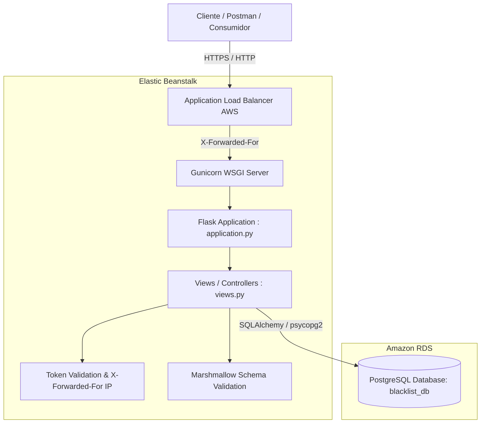

# Blacklist Microservice - Entrega 1

Microservicio de gestión de listas negras globales desarrollado en **Flask**, diseñado bajo principios de arquitectura limpia, empaquetado y desplegado de forma nativa en **AWS Elastic Beanstalk** con persistencia en **Amazon RDS (PostgreSQL)**.

---

## 1. Arquitectura y Estructura del Proyecto

El microservicio utiliza el patrón de diseño WSGI estándar para Elastic Beanstalk: el archivo de entrada se denomina `application.py` y la instancia exportada de Flask se llama `application`.

```plaintext
blacklist-microservice/
├── .ebextensions/
│   └── 01_flask.config          # Configuración WSGI y variables de entorno para AWS EB
├── models/
│   ├── __init__.py
│   └── models.py                # Entidad SQLAlchemy (Blacklist) y Esquema Marshmallow
├── views/
│   ├── __init__.py
│   └── views.py                 # Controladores Flask-RESTful, seguridad y Health Check
├── postman/
│   └── Blacklist_API.postman_collection.json # Colección de pruebas para Postman
├── tests/
│   ├── __init__.py
│   └── test_blacklist.py        # Suite de pruebas unitarias e integración con pytest
├── application.py               # Entry point requerido por AWS Elastic Beanstalk
├── config.py                    # Gestión desacoplada de variables de entorno y BD
├── requirements.txt             # Dependencias fijadas para el entorno
├── pytest.ini                   # Configuración para ejecución de pruebas
├── .gitignore                   # Exclusión de archivos de build, db y venv
└── README.md                    # Documentación técnica y guía de sustentación
```

### Diagrama de Arquitectura en AWS



---

## 2. Endpoints de la API

| Método | Endpoint | Autenticación | Código Éxito | Descripción |
| :--- | :--- | :--- | :--- | :--- |
| `GET` | `/health` o `/` | No | `200 OK` | Verificación de salud para AWS Load Balancer |
| `POST` | `/blacklists` | Bearer Token | `201 Created` | Registra un correo en la lista negra |
| `GET` | `/blacklists/<email>` | Bearer Token | `200 OK` | Consulta el estado de bloqueo de un correo |

### Especificación de Respuestas y Errores

* **`POST /blacklists`**:
  * **Payload esperado**:
    ```json
    {
      "email": "usuario@ejemplo.com",
      "app_uuid": "7a3512b9-e1e3-4c91-9e2b-ef792ef1729b",
      "blocked_reason": "Motivo opcional (máx 255 caracteres)"
    }
    ```
  * **201 Created**: Email agregado exitosamente, retorna `email` y `created_at`.
  * **400 Bad Request**: Validación fallida en formato de email o UUID.
  * **401 Unauthorized**: Falta encabezado `Authorization` o formato inválido.
  * **403 Forbidden**: Token estático no coincide con el configurado.
  * **409 Conflict**: El email ya existe en la lista negra global.

* **`GET /blacklists/<email>`**:
  * **200 OK (Bloqueado)**: `{"is_blacklisted": true, "blocked_reason": "..."}`
  * **200 OK (No Bloqueado)**: `{"is_blacklisted": false, "blocked_reason": null}`
  * **401 Unauthorized / 403 Forbidden**: Sin credenciales válidas.

---

## 3. Ejecución Local y Pruebas

### 3.1. Instalación de dependencias
```bash
# Crear entorno virtual
python -m venv .venv

# Activar entorno virtual
# En Windows PowerShell:
.\.venv\Scripts\Activate.ps1
# En Linux / macOS:
source .venv/bin/activate

# Instalar dependencias
pip install -r requirements.txt
```

### 3.2. Ejecutar la Suite de Pruebas Automatizadas
```bash
pytest -v
```
Se ejecutan 8 pruebas unitarias e integración que validan:
- Health check (200 OK)
- Validación de autorización (401 / 403)
- Validación de esquema de datos Marshmallow (400)
- Inserción y captura de IP real (`X-Forwarded-For`)
- Control de duplicados (409 Conflict)
- Búsqueda de email existente y no existente (200 OK)

### 3.3. Iniciar el servidor localmente
```bash
python application.py
```
El servidor quedará disponible en `http://localhost:5000` utilizando SQLite localmente (`blacklist_local.db`).

---

## 4. Guía de Despliegue en AWS (RDS + Elastic Beanstalk)

### Paso 1: Configurar Amazon RDS (PostgreSQL)
1. Ingrese a la consola de **Amazon RDS** > **Create database**.
2. Seleccione **Standard create** > **PostgreSQL** (versión 15.x o 16.x).
3. Seleccione el template **Free Tier** (db.t3.micro o db.t4g.micro).
4. Configure los parámetros:
   - **DB instance identifier**: `rds-blacklist-db`
   - **Master username**: `postgres`
   - **Master password**: (Defina una contraseña segura, ej. `AdminPass2026!`)
   - **Initial database name** (en Configuración Adicional): `blacklist_db`
5. En **Connectivity**:
   - Asocie la VPC por defecto.
   - En **VPC Security Group**: Cree o asigne un grupo de seguridad que permita tráfico entrante en el puerto `5432` desde el grupo de seguridad de Elastic Beanstalk.
6. Haga clic en **Create database** y copie el **Endpoint** una vez esté disponible.

### Paso 2: Crear el Entorno en AWS Elastic Beanstalk
1. Ingrese a la consola de **AWS Elastic Beanstalk** > **Create application**.
2. **Application name**: `blacklist-microservice`.
3. **Platform**: `Python`, versión `Python 3.11 running on 64bit Amazon Linux 2023` (o Python 3.12).
4. **Application code**: Seleccione **Upload your code** y suba el archivo `.zip` generado (ver sección de empaquetado).
5. En **Presets**: Seleccione **Single instance (free tier eligible)** o **High availability** según el requerimiento.
6. En **Environment properties** (Configuración del software):
   - `RDS_HOSTNAME`: `<endpoint-de-su-rds>`
   - `RDS_PORT`: `5432`
   - `RDS_DB_NAME`: `blacklist_db`
   - `RDS_USERNAME`: `postgres`
   - `RDS_PASSWORD`: `<su-password-de-rds>`
   - `STATIC_BEARER_TOKEN`: `token-estatico-secreto-12345`
   - `JWT_SECRET_KEY`: `super-secret-uniandes-key-2026`
7. Haga clic en **Deploy**. Elastic Beanstalk creará la instancia EC2, aprovisionará Gunicorn, instalará las dependencias y ejecutará automáticamente `db.create_all()` en PostgreSQL.

### Paso 3: Empaquetado del Código

> [!IMPORTANT]
> Nunca comprima la carpeta contenedora externa. Todos los archivos deben estar en la raíz del archivo `.zip`.

#### En Linux / macOS / Git Bash:
```bash
zip -r deploy_package_v1.zip . -x "*.git*" -x "*venv*" -x "*__pycache__*" -x "*.DS_Store" -x "*.db"
```

#### En Windows PowerShell:
```powershell
Compress-Archive -Path application.py, config.py, requirements.txt, models, views, .ebextensions -DestinationPath deploy_package_v1.zip -Force
```

---

## 5. Pruebas con Postman

La colección lista para importar se encuentra en:
`postman/Blacklist_API.postman_collection.json`

1. Abra Postman y haga clic en **Import**.
2. Seleccione el archivo `postman/Blacklist_API.postman_collection.json`.
3. Configure la variable `baseUrl`:
   - Para pruebas locales: `http://localhost:5000`
   - Para pruebas en AWS: `http://<tu-entorno>.elasticbeanstalk.com`
4. Ejecute las peticiones ordenadas de la colección para verificar el flujo de negocio y casos de error.