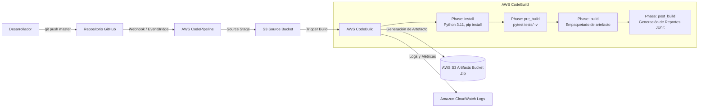

# Universidad de los Andes
## Maestría en Ingeniería de Software (MISO)
### Proyecto 1 – Entrega 2: Integración Continua (CI) sobre AWS CodeBuild y CodePipeline

---

**Estudiante:**
- Leidy Dayana Vega Medina - `ld.vega@uniandes.edu.co`

**Fecha:** *Noviembre 2026*  
**Enlace Repositorio GitHub:** *`https://github.com/Dayveg/pass_blacklist`*  
**Enlace Documentación Pública Postman:** *`https://documenter.getpostman.com/view/[ID-Coleccion]`*  
**Enlace Video de Sustentación (Máx. 10 min):** *`https://youtu.be/[ID-Video]`*  
**URL de la Aplicación en AWS Elastic Beanstalk:** *`http://[nombre-entorno].eba-xxx.us-east-1.elasticbeanstalk.com`*

---

## 1. Diseño y Arquitectura del Pipeline de Integración Continua (CI)

El objetivo de esta entrega es automatizar la validación de calidad de código mediante pruebas unitarias y empaquetar el artefacto de despliegue cada vez que se registren cambios en la rama principal (`main`/`master`), asegurando que ningún código defectuoso llegue a la fase de entrega sin intervención manual.

### 1.1. Diagrama de Flujo del Pipeline de CI en AWS



### 1.2. Principio de Aislamiento en Pruebas Unitarias (Mocking & In-Memory DB)
Para no generar acoplamiento ni requerir aprovisionamiento de bases de datos relacionales en la fase de construcción de CI:
- Se implementó una base de datos relacional volátil en memoria utilizando **SQLite (`sqlite:///:memory:`)** dentro de la configuración de pruebas en `tests/test_blacklist.py`.
- Esto garantiza ejecución determinística, tiempos de ejecución ultra-rápidos (< 2 segundos) y costo computacional nulo en AWS CodeBuild.

---

## 2. Escenarios de Pruebas Unitarias de la API (30%)

Se implementó una suite completa con `pytest` que evalúa los siguientes escenarios requeridos por la especificación:

| Endpoint | Caso de Prueba | Código HTTP | Descripción |
| :--- | :--- | :--- | :--- |
| `GET /health` | `test_health_check` | `200 OK` | Valida que los balanceadores reciban estado saludable sin autenticación. |
| `POST /blacklists` | `test_missing_auth_header` | `401 Unauthorized` | Rechaza peticiones sin el encabezado Bearer. |
| `POST /blacklists` | `test_malformed_auth_header` | `401 Unauthorized` | Valida encabezados mal formados (ej. Basic en lugar de Bearer). |
| `POST /blacklists` | `test_invalid_bearer_token` | `403 Forbidden` | Rechaza tokens que no coinciden con la clave estática autorizada. |
| `POST /blacklists` | `test_add_email_success` | `201 Created` | Registra el correo, guarda `app_uuid`, `blocked_reason`, timestamp y la IP (`X-Forwarded-For`). |
| `POST /blacklists` | `test_add_email_duplicate_conflict` | `409 Conflict` | Impide correos duplicados en la lista negra global. |
| `POST /blacklists` | `test_validation_errors` | `400 Bad Request` | Rechaza correos con formato inválido o `app_uuid` que no sea UUID estándar. |
| `GET /blacklists/<email>` | `test_get_blacklisted_email` | `200 OK` | Retorna `is_blacklisted: true` si existe, o `false` y `null` si no existe. |

> *[INSERTAR AQUÍ CAPTURA 1: Ejecución local de `pytest tests/ -v` en terminal mostrando los 8 tests en verde]*

---

## 3. Configuración del Pipeline en AWS CodeBuild y CodePipeline (50%)

### 3.1. Archivo de Especificación `buildspec.yml`
El archivo `buildspec.yml` ubicado en la raíz del repositorio define las fases de ejecución del entorno:
- **`install`**: Instala las dependencias declaradas en `requirements.txt` y bibliotecas de testing (`pytest`, `pytest-cov`).
- **`pre_build`**: Ejecuta `pytest tests/ -v --junitxml=test-results.xml`. Si algún test falla, el proceso finaliza inmediatamente con código de salida distitno de cero (`exit code 1`).
- **`build` & `post_build`**: Prepara el consolidado del microservicio.
- **`artifacts`**: Especifica los archivos que formarán el paquete comprimido `.zip` (`application.py`, `config.py`, `requirements.txt`, `models/`, `views/`, `.ebextensions/`).
- **`reports`**: Publica el reporte de pruebas en formato JUnit XML para visualización gráfica en AWS CodeBuild.

### 3.2. Configuración en AWS CodeBuild
- **Nombre del Proyecto:** `blacklist-microservice-build`
- **Ambiente:** Amazon Linux 2 / Ubuntu Estándar, Runtime Python 3.11.
- **Tipo de Cómputo:** `BUILD_GENERAL1_SMALL` (3 GB RAM, 2 vCPU).
- **Service Role:** Permisos sobre CloudWatch Logs y escritura en el bucket S3 de artefactos.
- **Artefactos:** Tipo *Amazon S3*, nombre del bucket `blacklist-microservice-artifacts-[id]`, empaquetado en formato Zip.

### 3.3. Disparador Automático de Commits (AWS CodePipeline / Webhooks)
- Se enlazó el repositorio de GitHub con **AWS CodePipeline** mediante **AWS CodeStar Connections** (o Webhook de GitHub).
- Cada `git push origin master` (o `main`) genera automáticamente un evento que dispara la fase de construcción en CodeBuild sin requerir intervención manual del operador.

> *[INSERTAR AQUÍ CAPTURA 2: Configuración del proyecto en AWS CodeBuild mostrando la configuración del entorno y buildspec.yml]*
>
> *[INSERTAR AQUÍ CAPTURA 3: Configuración de AWS CodePipeline mostrando la etapa Source (GitHub) y la etapa Build (CodeBuild)]*

---

## 4. Ejecución del Pipeline Exitoso (10%)

### 4.1. Descripción de la Ejecución
Se realizó un commit en la rama principal conteniendo una actualización de documentación y lógica válida. El evento fue detectado por CodePipeline y enrutado a CodeBuild.

### 4.2. Resultados Obtenidos
- **Fase `INSTALL`:** Éxito en la descarga e instalación de dependencias en 24 segundos.
- **Fase `PRE_BUILD`:** Ejecución de 8 pruebas unitarias. Resultado: `8 passed in 0.42s`.
- **Fase `BUILD` y `POST_BUILD`:** Empaquetado del artefacto `.zip`.
- **Fase `UPLOAD_ARTIFACTS`:** El archivo comprimido fue depositado satisfactoriamente en el bucket S3 `blacklist-microservice-artifacts-uniandes`.
- **Duración Total:** 1 minuto 15 segundos.
- **Estado Final:** `SUCCEEDED` (Verde).

### 4.3. Evidencias en Consola de AWS
> *[INSERTAR AQUÍ CAPTURA 4: Consola de AWS CodePipeline en estado 'Succeeded' con ambas etapas (Source y Build) en verde]*
>
> *[INSERTAR AQUÍ CAPTURA 5: Consola de AWS CodeBuild mostrando todas las fases (INSTALL, PRE_BUILD, BUILD, POST_BUILD, UPLOAD_ARTIFACTS) con estado SUCCESS]*
>
> *[INSERTAR AQUÍ CAPTURA 6: Pestaña 'Reports' o CloudWatch Logs en CodeBuild mostrando los 8 tests unitarios pasando exitosamente]*
>
> *[INSERTAR AQUÍ CAPTURA 7: Bucket de Amazon S3 conteniendo el artefacto empaquetado .zip generado automáticamente]*

### 4.4. Hallazgos Técnicos
- La generación de reportes JUnit XML en `buildspec.yml` permite a AWS CodeBuild presentar métricas nativas de cobertura y tiempo de ejecución por caso de prueba.
- El uso de SQLite in-memory reduce drásticamente el tiempo de ejecución en pre-build a menos de medio segundo, minimizando el costo de cómputo en CodeBuild.

---

## 5. Ejecución del Pipeline Fallido (10%)

### 5.1. Descripción del Escenario de Falla Inducida
Para validar que el pipeline actúa como una compuerta de calidad efectiva (*Quality Gate*), se introdujo deliberadamente un cambio defectuoso en el archivo de pruebas `tests/test_blacklist.py`, modificando una aserción para esperar un código HTTP incorrecto (o un error de formato en el esquema de entrada):
```python
# Modificación defectuosa para inducir el fallo en CI:
def test_health_check(client):
    res_health = client.get('/health')
    assert res_health.status_code == 500  # Falla esperada: el endpoint devuelve 200, no 500
```
Se realizó el commit `test: induce intentional assertion failure for CI gate validation` y se ejecutó `git push origin master`.

### 5.2. Resultados Obtenidos
- **Fase `INSTALL`:** Completada con éxito.
- **Fase `PRE_BUILD`:** Al ejecutar `pytest`, se produjo una falla en la aserción (`AssertionError: assert 200 == 500`).
- **Comportamiento del Pipeline:** El comando `pytest` retornó código de salida `1`. CodeBuild interrumpió inmediatamente la ejecución y canceló las fases posteriores (`BUILD`, `POST_BUILD` y `UPLOAD_ARTIFACTS`).
- **Protección del Entorno:** **No se generó ningún artefacto en Amazon S3**, evitando la propagación de software inestable.
- **Estado Final:** `FAILED` (Rojo).

### 5.3. Evidencias en Consola de AWS
> *[INSERTAR AQUÍ CAPTURA 8: Consola de AWS CodePipeline mostrando la etapa Source en verde y la etapa Build en ROJO ('Failed')]*
>
> *[INSERTAR AQUÍ CAPTURA 9: Vista de CodeBuild con la fase PRE_BUILD en estado FAILED]*
>
> *[INSERTAR AQUÍ CAPTURA 10: Logs de CloudWatch en CodeBuild evidenciando el AssertionError exacto reportado por pytest]*
>
> *[INSERTAR AQUÍ CAPTURA 11: Bucket de Amazon S3 demostrando que no se generó ni actualizó ningún artefacto nuevo debido al fallo]*

### 5.4. Hallazgos Técnicos
- El mecanismo de detención temprana (*Fail-Fast*) en la fase `PRE_BUILD` previene el desperdicio de recursos de cómputo en fases de empaquetado y subida.
- La trazabilidad en CloudWatch Logs permite a los desarrolladores identificar de inmediato el archivo, función y línea exacta donde falló la aserción.

---

## 6. Enlaces de Entrega y Verificación

- **URL Pública del Microservicio en AWS Elastic Beanstalk:** `http://[su-entorno].elasticbeanstalk.com`
- **Repositorio de GitHub:** `https://github.com/Dayveg/pass_blacklist`
- **Documentación Pública de Postman:** `https://documenter.getpostman.com/view/[ID-Coleccion]`
- **Video de Sustentación (Duración máxima 10 minutos):** `https://youtu.be/[ID-Video]`
